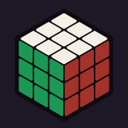
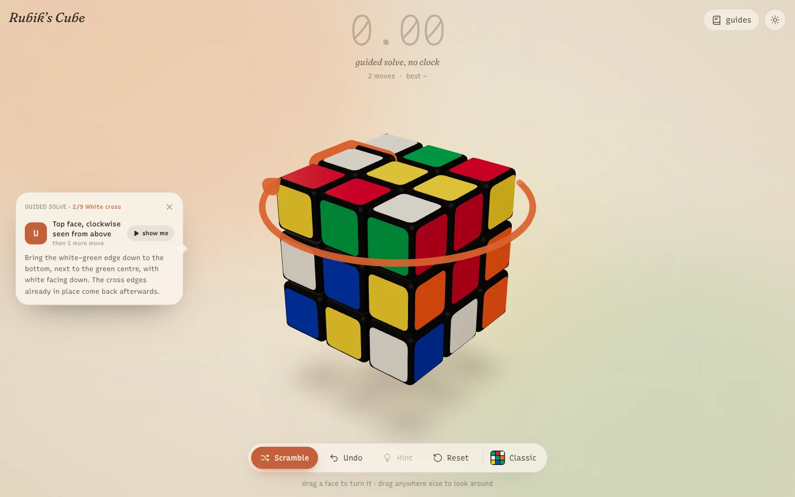
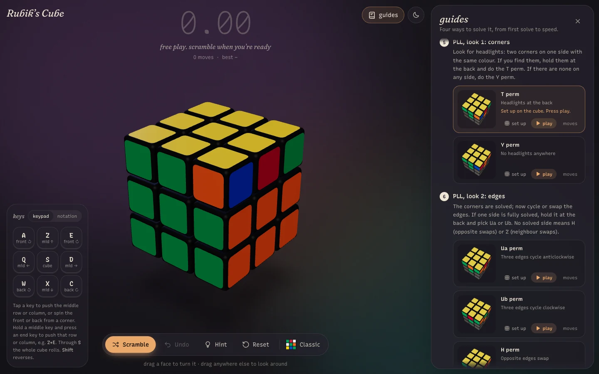

<p align="center">
  
</p>

# Rubik's Cube

<p align="center"><a href="https://fadi1089.github.io/Rubik/"><strong>▶ Play it in your browser</strong></a></p>

A 3D Rubik's cube for the browser that also teaches you to solve it. Turn layers by dragging or from the keyboard, race the timer, or let the guided solve walk you through the layer-by-layer method one move at a time.





## Features

- **Play:** drag a face to turn it, or use the AZE/QSD/WXC keypad (QWE/ASD/ZXC on QWERTY) or standard U D L R F B notation. Moves made during an animation are queued, never dropped.
- **Time yourself:** 25-move scrambles, a timer that starts on your first turn, undo, and best times saved locally.
- **Learn:** a guided solve and a hint button, both driven by a tutor that plans from whatever state your cube is in. A guides panel covers four methods (layer by layer, CFOP, Roux, ZZ) with a picture of every case and buttons to set it up or play it on the cube.
- **Make it yours:** five cube styles (Classic, Stickerless, Sorbet, Clay, Neon) and two themes, creme and dark.

Built with Vite, React, TypeScript (strict), Three.js via React Three Fiber and drei, Zustand and Tailwind CSS v4. Best times, the theme, the cube style and the key scheme are kept in `localStorage`.

## Controls

### Mouse and touch

Drag across a face to turn that layer in the direction you drag. Drag anywhere that isn't the cube or a control to look around, including over the title and other text, and scroll or pinch to zoom.

### Keyboard: keypad (default)

The nine keys under your left hand stand for the face of the cube you're looking at: each row of keys is a row of the cube, and each column of keys is a column. Keys are matched by position, so the same spots work on AZERTY and QWERTY:

```
AZERTY      QWERTY
A Z E       Q W E
Q S D       A S D
W X C       Z X C
```

- **Push the middle row or column.** Tap an edge key on its own: `Q`/`D` push the middle row left/right (E'/E), `Z`/`X` push the middle column up/down (M'/M).
- **Push an outer row or column.** Hold the middle key of a row or column and press one of its end keys to push that line towards the end key. `Z`+`E` pushes the top row right (U'), `Z`+`A` pushes it left (U), `D`+`E` pushes the right column up (R), `D`+`C` pushes it down (R'). The first key has to still be down when you press the second; keep it held and tap the end key again to repeat.
- **Roll the cube.** The middle row and column run through `S`, so `S`+`Z`/`Q`/`D`/`X` roll the whole cube up, left, right or down and bring another face to the front. The arrow keys do the same.
- **Spin the front or back.** Tap a corner on its own: `A`/`E` spin the front face anticlockwise/clockwise, `W`/`C` spin the back face (directions as seen from the front).
- **Shift** reverses any of these.

Taps fire when you release the key, and only if it wasn't used in a pair, so `Z`+`E` never also turns the middle column.

Letters above are AZERTY; on QWERTY use the keys in the same places. Turns follow the view: "right column" is whichever column is on your right, even after you orbit the camera or roll the cube. The key panel in the bottom-left corner shows the letters printed on your keyboard. While you hold a key, it shows what each partner key would do.

### Keyboard: notation

Switch the key panel to "notation" to use `U` `D` `L` `R` `F` `B` for clockwise turns and `Shift` for prime turns. Arrows still roll the cube.

`Ctrl+Z` / `⌘Z` undoes in both schemes.

### Game

Press Scramble for 25 random moves. The timer starts on your first turn after the scramble and stops when every face is a single colour. Rolling the cube doesn't start the timer or count as a move, but Undo steps back through rolls too. Moves made while an animation is playing are queued, so fast input isn't lost.

## Guided solve and hints

- **Start guided solve** (top of the guides panel) walks you through the layer-by-layer method from whatever state the cube is in, scrambling first if it's solved. The pieces to watch glow, and a piece round the back shows through the cube as a faint ghost. A curved arrow around the cube shows the next turn. A bubble explains the step and names the move ("Right face, clockwise seen from the right"). It sits beside the cube on wide screens and above the bottom bar on narrow ones; the cube stays centred. Make the move yourself, or press **show me**. Do something else and the tutor re-plans from where you are. Guided solves are untimed.
- **Hint** (bottom bar) shows the same advice for one step only and disappears after your next move. A timed solve that used a hint still finishes, but it can't set a best time.

The tutor lives in `src/solver/beginner.ts`. It reads the cube relative to its centres, so rolling the cube or turning middle layers mid-solve doesn't confuse it. The tests run it on dozens of scrambles and check every one ends solved.

## Solving guides

The **guides** button in the top-right corner opens a side panel with four methods, each split into steps:

| Method         | Level        | What it covers                                                       |
| -------------- | ------------ | -------------------------------------------------------------------- |
| Layer by layer | Start here   | The beginner method: 7 steps, 7 short algorithms                     |
| CFOP           | Intermediate | Cross, F2L basic inserts, 2-look OLL (10 algs) and 2-look PLL (6)    |
| Roux           | Advanced     | Two side blocks, 2-look CMLL, last six edges with M and U moves      |
| ZZ             | Advanced     | Edge orientation first, then F2L and last layer with R, U and L only |

Each case is shown as a picture of the app's Classic cube, held white-side down with yellow on top, with the stickers that don't matter greyed out. Steps without an algorithm show what the cube looks like once they're done. The move notation is behind a **moves** toggle, and it opens by itself while an algorithm plays so you can follow along. Every algorithm also has two buttons:

- **set up** resets the cube, turns it white-side down and applies the algorithm in reverse, so the cube shows the case that algorithm solves. It's untimed.
- **play** animates the algorithm at a followable pace and highlights each move. Played moves can be undone.

A "Reading the moves" section explains the notation. On wide screens the cube moves aside for the panel; on narrow screens the panel closes itself when you press set up or play. Each guide lists its sources. The guide text is in `src/guides/guides.ts`, and `src/guides/guides.test.ts` checks every algorithm against the cube model, so a typo in a sequence fails the tests.

### Regenerating the pictures

The pictures in `public/guide-images/` are rendered by the app itself. After changing a guide, start the dev server and open `http://localhost:5173/Rubik/?capture-guide-images`. The page renders every picture and saves it through a dev-only endpoint. `src/guides/images.test.ts` fails if any picture is missing. The capture page and the endpoint exist only in development and are left out of production builds.

## Styles and themes

Pick a cube style from the swatch at the end of the bottom bar:

| Style       | Look                                                  |
| ----------- | ----------------------------------------------------- |
| Classic     | Black plastic, standard sticker colours               |
| Stickerless | Large, bright tiles on a dark core                    |
| Sorbet      | Pastel tiles on soft charcoal                         |
| Clay        | Matte earth tones on a brown body                     |
| Neon        | Glowing, self-lit tiles on gloss black (best in dark) |

The sun/moon button in the top-right corner switches between the creme and dark themes. The first visit follows the system colour scheme. Styles are defined in `src/scene/cubeStyles.ts`, and theme colours are CSS variables at the top of `src/index.css`.

## Development

Requires Node.js 20.19+ or 22.12+ (CI uses Node 24).

```bash
npm install
npm run dev
```

The dev server prints its URL, which includes the base path (by default `http://localhost:5173/Rubik/`).

| Script                 | What it does                       |
| ---------------------- | ---------------------------------- |
| `npm run dev`          | Start the Vite dev server with HMR |
| `npm test`             | Run the Vitest suite once          |
| `npm run test:watch`   | Run Vitest in watch mode           |
| `npm run lint`         | ESLint                             |
| `npm run format`       | Format everything with Prettier    |
| `npm run format:check` | Check formatting without writing   |
| `npm run typecheck`    | Type-check with `tsc -b`           |
| `npm run build`        | Type-check and build to `dist/`    |
| `npm run preview`      | Serve the production build locally |

## Project layout

```
src/
  cube/    Pure TypeScript cube model: no React or Three imports (enforced by ESLint)
  scene/   React Three Fiber components: Cube, Cubie, Lights, CameraRig, drag handling, cube styles
  store/   Zustand stores: game (cube, move queue, history, timer, best time) and UI settings
  ui/      Tailwind HUD: timer, dock, style picker, theme toggle, key panel, solved banner
  input/   Keyboard controls, the keypad map and the chord tracker
  guides/  Solving guides as plain data, picture definitions, and tests that verify every algorithm
  solver/  The layer-by-layer tutor behind guided solves and hints
  dev/     Dev-only capture page for the guide pictures
```

### Cube model

The state is 27 cubies, each with an integer position (`-1`, `0` or `1` per axis) and a 3×3 integer rotation matrix. A move rotates the positions and orientations of the cubies in one layer by a multiple of 90°, so the arithmetic is exact and states can be compared directly. `toFacelets` projects the cubies onto the 54 stickers (URFDLB order), and `isSolved` checks that each face shows one colour.

Notation covers `U D L R F B`, wide turns `u d l r f b` (or `Rw`), the slices `M E S` and the whole-cube rotations `x y z`, with `'` for prime and `2` for half turns (`parseAlgorithm("R U R' U'")`). `view.ts` maps view-relative input (the layer on the viewer's right, a roll upwards) to these moves, given which cube axes face the camera. `generateScramble(seed)` is deterministic for a given seed and never repeats a face or turns one axis three times in a row.

### Animation

The store keeps a FIFO queue of pending moves. Every frame, `Cube` rebuilds the cubie transforms from the committed state and applies the head of the queue as a partial rotation. When that rotation finishes, the move is committed to the model in the same frame, so the rendered cube and the logical cube never disagree. Each queue entry has a unique id and can only be committed once.

## Tests

```bash
npm test
```

The suite covers the model and the store:

- every move (outer faces, slices and rotations; single, prime and double) applied four times returns the original state
- a sequence followed by its inverse returns to solved
- `isSolved` holds for a fresh cube and after a whole-cube rotation, and fails after any single layer move or a scramble
- `x y z` match their layer-by-layer equivalents, and view-relative turns and rolls map to the right notation from different viewpoints
- keypad chords, repeats, edge and corner taps, and Shift produce the right moves
- every algorithm in the guides leaves the part of the cube it should alone (for example, each PLL keeps the first two layers and the top colour), and every guide picture exists
- the tutor solves 30 seeded scrambles by following its own hints, never moves backwards through the stages, and copes with rolled and sliced cubes
- guided mode advances when you follow it, re-plans when you don't, and hints keep a solve off the best-time list
- notation round-trips, and scrambles are deterministic and follow their rules
- the store commits queued moves exactly once, undo reverses queued moves, the timer runs from the first turn to the solve, and rotations don't count as moves

## Build

```bash
npm run build
npm run preview
```

Assets are built for the base path in the `BASE_PATH` environment variable, defaulting to `/Rubik/`, which matches `https://<username>.gitlab.io/Rubik/`. For a project with a different name, or to serve from the root, set it explicitly:

```bash
BASE_PATH=/my-cube/ npm run build
```

## Deploy to GitHub Pages

The live site at <https://fadi1089.github.io/Rubik/> is built by `.github/workflows/pages.yml` on every push to `main`. The workflow installs dependencies, lints, runs the tests, builds with the base path GitHub Pages reports (`/Rubik/` here, `/` on a custom domain) and deploys `dist/`. You can also start it by hand from the Actions tab.

For a fork, enable Pages once under **Settings → Pages → Build and deployment → Source: GitHub Actions**, then push to `main`.

## Deploy to GitLab Pages

`.gitlab-ci.yml` defines two jobs on the `node:24-alpine` image:

- **`pages`** runs on the default branch: `npm ci`, `npm test`, `npm run build`, then publishes `dist/` as the `public` artifact. GitLab Pages serves that artifact.
- **`check`** runs on merge requests and other branches: install, lint, test and build, without deploying.

To deploy:

1. Create a GitLab project and push this repository to it. This repo's `origin` points at GitHub, so add GitLab as a second remote:
   ```bash
   git remote add gitlab git@gitlab.com:<username>/<repo-name>.git
   ```
   ```bash
   git push gitlab main
   ```
2. Wait for the pipeline on the default branch to finish. The site appears under **Deploy → Pages** in the project.

You don't need to set `BASE_PATH` yourself in CI. The `pages` job derives it from GitLab's `$CI_PAGES_URL`, so it is `/<repo-name>/` for `https://<username>.gitlab.io/<repo-name>/` and `/` when the project uses a unique Pages domain (`https://<project>-<hash>.gitlab.io`, the default for new projects on recent GitLab versions).
